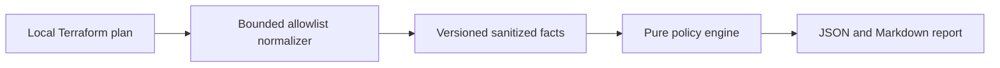

# Terramind

AI-powered Terraform risk analysis and infrastructure intelligence on Google Cloud.

Terramind is a personal portfolio project demonstrating cloud engineering,
infrastructure security and applied AI through a reproducible Terraform review workflow.

**Available:** four deterministic GCP rules, a local allowlist normalizer,
JSON/Markdown reports, synthetic runbook ingestion, Firestore vector retrieval and
validated Gemini advisory output with deterministic fallback. The private Cloud Run
analysis API, expiring report storage and minimal report page are deployed and
verified. Protected GitHub Actions delivery uses short-lived WIF credentials and
immutable image digests. Hosted CI passes, including the restricted container.
A live cloud analysis preserved all four HIGH findings and validated ten sources;
its saved JSON, Markdown and HTML passed authenticated checks. Anonymous access was
rejected. See the [deployment evidence](docs/api-delivery-verification.md).
All repository samples are synthetic. Resources remain active with minimum zero
and maximum one Cloud Run instance; final cleanup is pending.
Terramind is not a full security scanner and never approves or applies changes.

## Quick start

Install Python 3.12+ and [uv](https://docs.astral.sh/uv/getting-started/installation/).
From the repository root:

```sh
uv sync --locked
uv run --locked python scripts/check.py
uv run --locked python scripts/demo_offline.py
```

With GNU Make installed: `make setup`, `make lint`, `make test`,
`make demo-offline`. The direct uv commands work in Windows PowerShell too.
Setup needs package downloads; subsequent offline analysis makes no network calls.

The demo writes `artifacts/demo-report.json`, `artifacts/demo-report.md` and a
normalized combined synthetic sample. Open the Markdown report to see all four
HIGH findings. Analysis IDs/timestamps vary; policy findings are deterministic.

```sh
uv run --locked terramind analyze --input examples/normalized-plans/public_bucket.json --output artifacts/public-bucket.md --format markdown
uv run --locked terramind normalize --input /local/private/tfplan.json --output /local/private/normalized.json
```

Raw `terraform show -json` output can contain plaintext secrets. Keep it outside
the repository. The CLI reads it locally, rejects files over 5 MiB or 100 change
records, and emits at most 256 KiB. Do not upload raw plans, state or credentials.
Only synthetic normalized data is approved for the cloud demo.

## Rules

| Rule | Scope | Outcome |
| --- | --- | --- |
| TM-GCP-001 | New public bucket object-read grant | HIGH; REVIEW when prevention is verified or applicability uncertain |
| TM-GCP-002 | World ingress allowing SSH/RDP | HIGH; does not establish VM reachability |
| TM-GCP-003 | Newly granted project owner/editor | HIGH; least-privilege review |
| TM-GCP-004 | Bucket/database/persistent-resource deletion or replacement | HIGH / REVIEW; backup state is not inferred |

No match produces `NO_KNOWN_FINDINGS`. REVIEW still contributes to overall HIGH
risk. No model can alter findings. See [schema and supported scope](docs/normalization.md).

## Architecture and roadmap



`src/terramind/schemas` defines closed contracts; `normalizer` is the local privacy
boundary; `policies` has pure rules; `reports` renders findings; `cli.py` is an
adapter. Tests cover unit behavior, CLI integration and data leakage.

- [Roadmap and release gates](docs/roadmap.md)
- [Architecture decisions](docs/architecture.md)
- [Threat model](docs/threat-model.md)
- [Two-minute demo](docs/demo-script.md)
- [Local evaluation](docs/evaluation.md)
- [Retrieval and explanations](docs/retrieval-and-explanations.md)
- [Retrieval verification](docs/retrieval-verification.md)
- [Analysis API and local report demo](docs/analysis-api.md)
- [Controlled delivery](docs/delivery.md)
- [API and delivery verification](docs/api-delivery-verification.md)
- [Cloud setup and deployment](docs/setup-gcp.md)
- [Cost, rollback and cleanup](docs/cost-and-cleanup.md)
- [Infrastructure security exceptions](docs/security-exceptions.md)
- [Changelog](CHANGELOG.md)

Run the local API with `uv run --locked --extra api python -m terramind.api`.
It binds to `127.0.0.1:8080`; Google authentication is enforced by Cloud Run when
deployed, not by the local development server. `/health` is the external liveness
endpoint; `/healthz` remains available for container probes.

Open `http://127.0.0.1:8080/demo` to analyze the packaged synthetic sample and view
the report. Local mode makes no cloud calls and keeps at most 128 expiring reports
in process memory. Verify the running API with
`uv run --locked python scripts/demo_cloud.py --url http://127.0.0.1:8080 --local`.
See the API guide for request limits, storage behavior and authenticated cloud use.

Validate the ten synthetic knowledge documents with
`uv run --locked terramind-knowledge plan`. Run
`uv run --locked python scripts/demo_retrieval.py` for a credential-free integration
demo using explicitly labeled local test doubles. The separate cloud commands
require approved project settings and `--execute`; see the retrieval guide.

Validate the infrastructure without cloud credentials:

```sh
uv run --locked python scripts/check_infrastructure.py --scan
```

This requires Terraform on PATH; use `--terraform /absolute/path/to/terraform`
otherwise. The checker uses mock-provider plans and an isolated local data directory.
It never applies changes or initializes a remote backend. The separate, approved
cloud deployment is recorded in [cloud verification](docs/cloud-foundation-verification.md).
