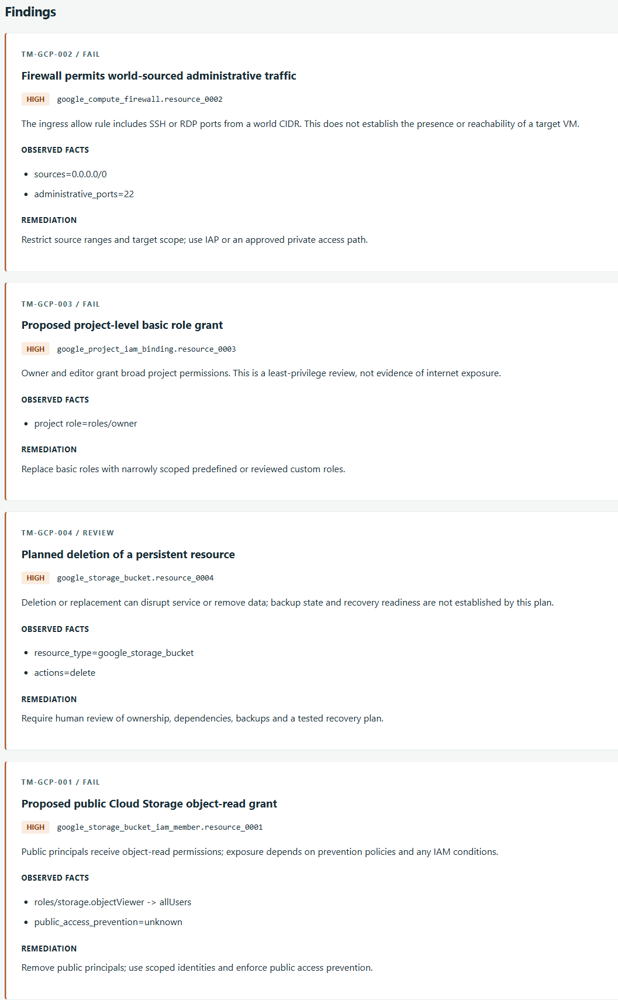
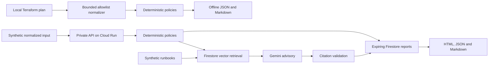

# Terramind

<p align="center">
  <picture>
    <source media="(prefers-color-scheme: dark)" srcset="docs/brand/terramind-logo-dark.png">
    
  </picture>
</p>

**Terraform change intelligence for Google Cloud.**

Terramind analyzes proposed infrastructure changes and produces risk reports with
affected resources, policy findings, supporting evidence and remediation guidance.
Run deterministic checks locally, or use the private analysis API for explanations
grounded in retrieved runbooks.

The policy engine determines findings and severity. Gemini adds advisory context
with validated source references. Approval and deployment remain with the reviewer.
All included examples and hosted analysis workflows use synthetic data.

[Quick start](#quick-start) · [Report interface](#report-interface) ·
[Risk policies](#risk-policies) · [Architecture](#architecture) ·
[Documentation](#documentation)

## Capabilities

| Capability | What it provides |
| --- | --- |
| Deterministic risk checks | Four GCP policies covering public storage access, administrative ingress, privileged IAM grants and destructive changes |
| Optional policy packs | Two storage and two database hardening checks, explicitly selected with normalized schema 1.1 |
| Grounded explanations | Firestore vector retrieval and Gemini advisory text with validated runbook references |
| Traceable reports | Resource aliases, observed facts, severity, remediation and explicit limitations |
| Offline analysis | A local CLI with JSON and Markdown output, without Google credentials or model calls |
| Private analysis API | IAM-protected Cloud Run delivery, expiring reports, a browser interface and export endpoints |
| Synthetic PR review | Opt-in trusted workflow with a real managed bot comment, neutral head check and verified rerun behavior |
| Eventarc source indexing | Generation-bound synthetic receiver with live delivery, durable receipts, replay deduplication and expired-lease recovery |
| Incident Memory | Local lexical similarity over fabricated incidents, with explicit evidence labels and source hashes |
| User portal | Verified Google login, owned Firestore reports, filtered history, exports and persistence across private Cloud Run revisions; local SQLite demo also available |

Retrieval or model failures preserve the deterministic findings and produce a
visible fallback. Terramind never approves or applies infrastructure changes.

## Quick start

Install Python 3.12+ and [uv](https://docs.astral.sh/uv/getting-started/installation/), then:

```sh
git clone https://github.com/mdaninas/terramind-gcp.git
cd terramind-gcp
uv sync --locked
uv run --locked python scripts/demo_offline.py
```

Expected output:

```text
HIGH: 4 deterministic findings
Reports: artifacts/demo-report.json and artifacts/demo-report.md
```

Open either report to inspect the synthetic changes and their findings. No GCP
credentials, Terraform installation or model access are required. Dependency
installation downloads packages; the analysis itself makes no provider calls.

The commands above also work in PowerShell. With GNU Make installed, `make setup`
and `make demo-offline` provide the equivalent setup and sample analysis.

## Report interface

Start the local API and report interface:

```sh
uv run --locked --extra api python -m terramind.api
```

Open [the local interface](http://127.0.0.1:8080/demo) and select
**Analyze synthetic sample**. The saved report includes overall risk, changed
resources, individual findings, evidence and remediation. Export it as Markdown
or inspect the JSON response from the same page.

Local mode makes no Google service calls. It holds at most 128 expiring reports
in memory and discards them on restart.

<details>
<summary>View findings from a synthetic sample</summary>



Actual findings from the local offline interface. This sample contains no
model-generated advisory text.

</details>

For an example with grounded explanations and validated source references, see
the [synthetic Gemini report](examples/generated-reports/grounded-synthetic.md).
The [walkthrough](docs/demo-script.md) covers the complete analysis and export flow.

In a second terminal, verify the running local API:

```sh
uv run --locked python scripts/demo_cloud.py --url http://127.0.0.1:8080 --local
```

## Risk policies

| Rule | Supported change | Outcome |
| --- | --- | --- |
| TM-GCP-001 | New public bucket object-read grant | HIGH; REVIEW when prevention is verified or applicability uncertain |
| TM-GCP-002 | World ingress allowing SSH/RDP | HIGH; does not establish VM reachability |
| TM-GCP-003 | Newly granted project owner/editor | HIGH; least-privilege review |
| TM-GCP-004 | Bucket/database/persistent-resource deletion or replacement | HIGH / REVIEW; backup state is not inferred |

`REVIEW` is a finding status that requires human investigation and contributes to
overall HIGH risk. When no supported rule matches, the report returns
`NO_KNOWN_FINDINGS`; this is not a guarantee that a change is safe.

See the [normalization contract](docs/normalization.md) for the supported inputs
and the [threat model](docs/threat-model.md) for analysis boundaries.

## CLI usage

Analyze a packaged normalized plan and write a Markdown report:

```sh
uv run --locked terramind analyze --input examples/normalized-plans/public_bucket.json --output artifacts/public-bucket.md --format markdown
```

Use `--format json` for structured output. The offline CLI analyzes normalized
facts and does not invoke retrieval, models or cloud storage.

To normalize a local `terraform show -json` file, keep both files outside the
repository and pass their paths explicitly:

```sh
uv run --locked terramind normalize --input /local/private/tfplan.json --output /local/private/normalized.json
```

Normalized local plans are for offline analysis. The hosted API accepts only the
synthetic request contract described in the [API reference](docs/analysis-api.md).

## Architecture



Typed contracts keep policies independent of HTTP and cloud SDKs. Separate adapters
handle storage, retrieval and model calls. The API uses FastAPI; cloud storage and
retrieval use Firestore and Cloud Storage; Gemini produces advisory explanations.
Citation validation checks source references before the advisory is included in a
report. Local and hosted analysis share the same deterministic policy rules.

See [architecture decisions](docs/architecture.md) and
[retrieval and explanations](docs/retrieval-and-explanations.md) for the full design.

## Data handling

All committed fixtures, runbooks and example reports use synthetic data. Hosted
requests must also contain synthetic facts; a source label alone cannot establish
that arbitrary caller data is safe.

Raw Terraform plans can contain plaintext secrets. Keep plan JSON, state and
credentials outside the repository and hosted API. The local normalizer removes
private identifiers, prior values, outputs and unsupported fields. It rejects
inputs over 5 MiB or 100 changes and emits at most 256 KiB.

Reports check a defined policy set. They do not establish deployed exposure,
backup readiness or complete security coverage. AI output is advisory, and
retrieval/model failures do not change policy severity.

## Deployment

The separate [user portal](docs/user-portal.md) uses SQLite locally or Firestore
on private Cloud Run. Real Google login, four synthetic report scenarios, exports,
filters, logout and persistence across revisions were exercised on 2026-11-10.
See the [hosted verification record](docs/live-integrations-verification.md).

Current operational status: **billing is disabled and the project is retained**.
The approved live window ended after six analysis submissions. The core portal
sample returned a validated Gemini advisory; both hardening samples used visible
fallback with their policy findings preserved. The latest deployment promoted its
image successfully but failed its strict advisory smoke. Hosted services are
paused. See the [evidence](docs/evaluations/live-integrations-2026-11-10.json) and
[cost controls](docs/cost-and-cleanup.md). Resource deletion is not claimed.

Terraform configurations define the private Cloud Run service, Firestore vector
index, runbook storage, scoped identities and runtime settings. GitHub Actions
uses Workload Identity Federation for short-lived deployment credentials. Manual
delivery promotes an immutable image from its own trusted build; pull request CI
receives no Google credentials.

Cloud Run invoker IAM protects every hosted route, including assets and exports.
The local analysis API binds to loopback and does not implement Google authentication.
For authorized browser access to a deployed instance, follow the
[authenticated proxy instructions](docs/analysis-api.md#authentication-and-presentation).

Start with [GCP setup](docs/setup-gcp.md), then follow the
[delivery workflow](docs/delivery.md). Review [cost controls and cleanup](docs/cost-and-cleanup.md)
before provisioning: budget alerts notify but do not cap spending. Provisioning,
IAM changes, Terraform apply, ingestion and paid model calls require explicit approval.

Recorded deployment and analysis results are available in the
[API verification record](docs/api-delivery-verification.md), including the tested
source, delivery configuration and synthetic end-to-end analysis.

## Development

Run lint, formatting, type checks, schema checks and tests:

```sh
uv run --locked python scripts/check.py
```

With GNU Make installed, the equivalent check targets are `make lint` and `make test`.
The [release verification record](docs/release-verification.md) documents command
reproduction and package build results.

Additional checks and local workflows:

```sh
uv run --locked terramind-knowledge plan
uv run --locked python scripts/demo_retrieval.py
uv run --locked python scripts/check_public_files.py
uv run --locked python scripts/check_infrastructure.py --scan
```

The retrieval workflow above uses labeled local test doubles and makes no provider
calls. Infrastructure checks require Terraform on PATH (or
`--terraform /absolute/path/to/terraform`) and use mock plans, without a remote
backend or apply.

## Documentation

| Topic | References |
| --- | --- |
| Usage | [Walkthrough](docs/demo-script.md), [analysis API](docs/analysis-api.md), [normalization](docs/normalization.md) |
| Design | [Architecture](docs/architecture.md), [retrieval and explanations](docs/retrieval-and-explanations.md), [threat model](docs/threat-model.md) |
| Operations | [GCP setup](docs/setup-gcp.md), [delivery](docs/delivery.md), [cost and cleanup](docs/cost-and-cleanup.md) |
| Integrations | [Synthetic PR review](docs/pr-integration.md), [Eventarc indexing](docs/eventarc-indexing.md), [integration checks](docs/integrations-verification.md) |
| User workspace | [Incident Memory](docs/incident-memory.md), [user portal](docs/user-portal.md), [portal verification](docs/portal-verification.md) |
| Additional policies | [Pack definitions and usage](docs/policy-packs.md), [local verification](docs/policy-packs-verification.md) |
| Verification | [Hosted integrations](docs/live-integrations-verification.md), [evaluations](docs/evaluation.md), [retrieval checks](docs/retrieval-verification.md), [cloud foundation](docs/cloud-foundation-verification.md), [release checks](docs/release-verification.md) |
| Project | [Roadmap](docs/roadmap.md), [changelog](CHANGELOG.md), [security exceptions](docs/security-exceptions.md) |

PR review, Eventarc indexing, synthetic incident similarity and the user portal
are implemented, with local and hosted verification scopes documented separately.
The twelve-document corpus was synchronized through real Eventarc delivery.
Optional packs produced their expected findings on GCP; successful live advisory
output for those two packs remains unverified. Billing is disabled after testing.
