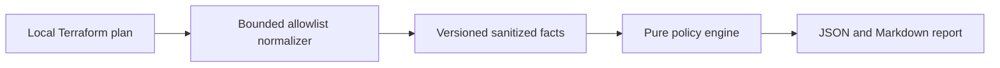

# Terramind

AI-powered Terraform risk analysis and infrastructure intelligence on Google Cloud.

Terramind is a personal portfolio project demonstrating cloud engineering,
infrastructure security and applied AI through a reproducible Terraform review workflow.

**Offline analyzer.** Four deterministic GCP rules, a local allowlist normalizer,
and JSON/Markdown reports work without cloud credentials. Gemini, Firestore,
FastAPI, Terraform infrastructure and GitHub Actions are planned;
they are not implemented or deployed yet. All repository samples are synthetic.
Terramind is not a full security scanner and never approves or applies changes.

## Quick start

Install Python 3.12+ and [uv](https://docs.astral.sh/uv/getting-started/installation/).
From the repository root:

```sh
uv sync --locked
uv run --locked python scripts/check.py
uv run --locked python scripts/demo_offline.py
```

With GNU Make installed: `make setup`, `make lint`, `make test`,
`make demo-offline`. The direct uv commands work in Windows PowerShell too.
Setup needs package downloads; subsequent offline analysis makes no network calls.

The demo writes `artifacts/demo-report.json`, `artifacts/demo-report.md` and a
normalized combined synthetic sample. Open the Markdown report to see all four
HIGH findings. Analysis IDs/timestamps vary; policy findings are deterministic.

```sh
uv run --locked terramind analyze --input examples/normalized-plans/public_bucket.json --output artifacts/public-bucket.md --format markdown
uv run --locked terramind normalize --input /local/private/tfplan.json --output /local/private/normalized.json
```

Raw `terraform show -json` output can contain plaintext secrets. Keep it outside
the repository. The CLI reads it locally, rejects files over 5 MiB or 100 change
records, and emits at most 256 KiB. Do not upload raw plans, state or credentials.
Only synthetic normalized data is approved for the eventual cloud demo.

## Rules

| Rule | Scope | Outcome |
| --- | --- | --- |
| TM-GCP-001 | New public bucket object-read grant | HIGH; REVIEW when prevention is verified or applicability uncertain |
| TM-GCP-002 | World ingress allowing SSH/RDP | HIGH; does not establish VM reachability |
| TM-GCP-003 | Newly granted project owner/editor | HIGH; least-privilege review |
| TM-GCP-004 | Bucket/database/persistent-resource deletion or replacement | HIGH / REVIEW; backup state is not inferred |

No match produces `NO_KNOWN_FINDINGS`. REVIEW still contributes to overall HIGH
risk. No model can alter findings. See [schema and supported scope](docs/normalization.md).

## Architecture and roadmap



`src/terramind/schemas` defines closed contracts; `normalizer` is the local privacy
boundary; `policies` has pure rules; `reports` renders findings; `cli.py` is an
adapter. Tests cover unit behavior, CLI integration and data leakage.

- [Roadmap and release gates](docs/roadmap.md)
- [Architecture decisions](docs/architecture.md)
- [Threat model](docs/threat-model.md)
- [Two-minute demo](docs/demo-script.md)
- [Local evaluation](docs/evaluation.md)
- [Changelog](CHANGELOG.md)

GCP deployment is planned and has not been verified. The current demo runs
locally without paid resources. Phase 2 features remain outside the current scope.
