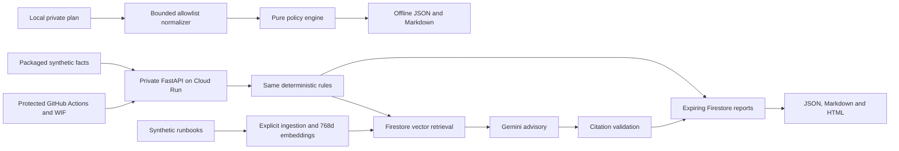

# Terramind

<p align="center">
  <picture>
    <source media="(prefers-color-scheme: dark)" srcset="docs/brand/terramind-logo-dark.png">
    
  </picture>
</p>

AI-powered Terraform risk analysis and infrastructure intelligence on Google Cloud.

Terramind reviews proposed Terraform changes with four deterministic GCP rules,
then optionally uses Firestore vector retrieval and Gemini to explain the findings
with traceable runbook references. The policy engine owns severity; AI output is advisory.

Built as a personal portfolio project covering Python, FastAPI, Terraform, GCP IAM,
Cloud Run, retrieval-augmented generation and GitHub Actions delivery.

The offline CLI and private cloud analysis API are implemented and verified.
A protected WIF deployment passed, and a live analysis preserved four HIGH findings
with ten validated sources. See the [verification record](docs/api-delivery-verification.md).
All examples are synthetic. Terramind checks a limited policy set and never approves
or applies infrastructure changes. Cloud resources remain active; see
[cost controls and cleanup](docs/cost-and-cleanup.md).

## Quick start

Install Python 3.12+ and [uv](https://docs.astral.sh/uv/getting-started/installation/), then:

```sh
git clone https://github.com/mdaninas/terramind-gcp.git
cd terramind-gcp
uv sync --locked
uv run --locked python scripts/demo_offline.py
```

Open `artifacts/demo-report.md` or `artifacts/demo-report.json`. Expect HIGH overall
risk and four findings covering public bucket access, world SSH ingress, a project
owner grant and bucket deletion. IDs and timestamps vary; policy findings are deterministic.
No GCP credentials, Terraform CLI or model calls are needed for this demo.
Initial dependency installation requires package downloads.

Run the quality checks:

```sh
uv run --locked python scripts/check.py
```

With GNU Make installed, the equivalent targets are `make setup`, `make lint`,
`make test` and `make demo-offline`. The direct uv commands also work in PowerShell.
A [fresh GitHub clone](docs/release-verification.md) passed all 297 tests, both
command paths and package builds without Google credentials.

## Report preview

```sh
uv run --locked --extra api python -m terramind.api
```

Open `http://127.0.0.1:8080/demo` and select **Analyze synthetic sample**. The report
includes risk, changed resources, evidence, remediation, limitations and JSON/Markdown
exports. Local mode keeps up to 128 expiring reports in memory, clears them on
restart and makes no Google service calls.


Actual local offline UI capture at 1440 x 1080. This screenshot does not show a
cloud-generated advisory. See [finding details](docs/images/findings-desktop.png),
[mobile view](docs/images/report-mobile.png) and the [two-minute walkthrough](docs/demo-script.md).
For a real grounded explanation, inspect the
[synthetic Gemini report](examples/generated-reports/grounded-synthetic.md) and
[cloud API evidence](docs/evaluations/api-delivery-2026-11-10.json).

In a second terminal, verify the running local API:

```sh
uv run --locked python scripts/demo_cloud.py --url http://127.0.0.1:8080 --local
```

Cloud Run enforces Google invoker IAM on every hosted route. A local server does
not implement Google authentication. For an authorized browser session, use the
[authenticated proxy instructions](docs/analysis-api.md#authentication-and-presentation).

## Rules and privacy

| Rule | Supported change | Outcome |
| --- | --- | --- |
| TM-GCP-001 | New public bucket object-read grant | HIGH; REVIEW when prevention is verified or applicability uncertain |
| TM-GCP-002 | World ingress allowing SSH/RDP | HIGH; does not establish VM reachability |
| TM-GCP-003 | Newly granted project owner/editor | HIGH; least-privilege review |
| TM-GCP-004 | Bucket/database/persistent-resource deletion or replacement | HIGH / REVIEW; backup state is not inferred |

No match produces `NO_KNOWN_FINDINGS`. REVIEW still contributes to overall HIGH
risk. Model failures preserve deterministic findings with a visible fallback.
Storage failures return a controlled error. See the
[supported scope](docs/normalization.md) and [threat model](docs/threat-model.md).

```sh
uv run --locked terramind analyze --input examples/normalized-plans/public_bucket.json --output artifacts/public-bucket.md --format markdown
uv run --locked terramind normalize --input /local/private/tfplan.json --output /local/private/normalized.json
```

Raw `terraform show -json` output can contain plaintext secrets. Keep it outside
the repository. The local normalizer projects allowlisted facts, rejects input over
5 MiB or 100 changes and emits at most 256 KiB. It removes private identifiers,
prior values, outputs and unsupported fields. Never upload raw plans, state or
credentials. The hosted demo accepts synthetic normalized facts only; a source
label cannot prove arbitrary caller data is non-sensitive.

## Architecture



Typed contracts keep policies independent of HTTP and cloud SDKs. Separate adapters
handle storage, retrieval and model calls. Terraform manages private storage, the
vector index, scoped identities and runtime configuration. The manual deployment
workflow promotes only an immutable image from its own trusted build; pull request
CI receives no Google credentials.

Cloud Run uses minimum zero and maximum one instance in the active deployment.
The monthly IDR 180,000 alert does not cap spending. Storage, retrieval and model
calls remain metered. Cleanup is documented and has not been executed.

## Development and evidence

```sh
uv run --locked terramind-knowledge plan
uv run --locked python scripts/demo_retrieval.py
uv run --locked python scripts/check_infrastructure.py --scan
```

The retrieval demo uses labeled local test doubles and makes no provider calls.
Infrastructure verification needs Terraform on PATH (or `--terraform /absolute/path/to/terraform`)
and uses mock plans, without a remote backend or apply. Cloud ingestion, model
requests, provisioning and IAM changes require explicit approval.

- [Walkthrough](docs/demo-script.md) and [release verification](docs/release-verification.md)
- [Architecture decisions](docs/architecture.md) and [roadmap](docs/roadmap.md)
- [Evaluation results](docs/evaluation.md) and [retrieval verification](docs/retrieval-verification.md)
- [Retrieval and explanations](docs/retrieval-and-explanations.md)
- [Analysis API](docs/analysis-api.md) and [delivery workflow](docs/delivery.md)
- [Cloud setup](docs/setup-gcp.md) and [foundation verification](docs/cloud-foundation-verification.md)
- [Cost, rollback and cleanup](docs/cost-and-cleanup.md)
- [Security exceptions](docs/security-exceptions.md) and [changelog](CHANGELOG.md)

Pull request comments, Eventarc indexing, additional policies and a full dashboard
are deferred beyond the MVP.
