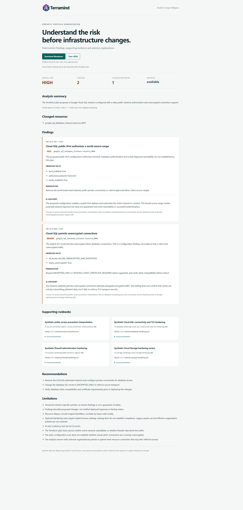

# Live advisory verification

The approved 2026-11-11 window resolved the two remaining hosted verification
gaps: validated Storage and Database hardening advisories, and a successful
strict deployment smoke. All inputs were synthetic. Billing was disabled again
at 09:01 UTC (16:01 Asia/Jakarta), the project was retained, and both authenticated
local proxies were stopped. See the [content-free evidence](evaluations/advisory-live-2026-11-11.json).

## Verified result

[Protected deployment 42989951299](https://github.com/mdaninas/terramind-gcp/actions/runs/42989951299)
passed its trusted build, normal environment approval, WIF deployment and strict
three-scenario smoke. It deployed source
`c8220f5de69a7496d4f2d1d3526090a1f411b939` with immutable digest
`sha256:d37a72be12c3f460e9ba9857936d94f7ebdd76edf764366ec545d88afe6bdb06`.

| Scenario | Findings | Retrieved sources | Validated advisory | Analysis HTTP request |
| --- | --- | --- | --- | --- |
| Core risk | 4 | 8 | Gemini 3.5 Flash | 9.693 s |
| Storage hardening | 2 | 2 | Gemini 3.5 Flash | 3.199 s |
| Database hardening | 2 | 4 | Gemini 3.5 Flash | 2.913 s |

Each case returned HTTP 201, preserved the expected deterministic findings and
pack versions, rejected anonymous access, and passed exact explanation coverage
and canonical source provenance checks. Saved-report JSON round trips, Markdown
exports and report pages passed. Times measure the complete analysis request,
not isolated model RPC latency. The three stored reports were independently read
and validated; the real Database report was also inspected in the browser.

## Failure and correction

The first [three-scenario attempt](https://github.com/mdaninas/terramind-gcp/actions/runs/42988189930)
validated Storage advice, but core generation was rejected by the provider and
Database output failed its response contract. All policy findings were retained.
The failed workflow remains failed; it was not bypassed or relabeled.

The correction uses compact request-local finding/source aliases in the provider
schema, then restores only registered aliases to canonical identifiers before
the existing strict validation. Unknown identifiers, severity overrides and
non-ASCII prose remain rejected. Prose instructions avoid assertions rejected by
the existing guard. The earlier Database response was not retained, so its exact
validation cause is unknown. See the [implementation record](advisory-verification-preparation.md).

The correction passed 517 local tests with 97.19% normalization/policy coverage,
Ruff, strict mypy on 71 source files and public-file privacy checks.
[Source CI 42989767579](https://github.com/mdaninas/terramind-gcp/actions/runs/42989767579)
passed. Call, deadline, retry and token ceilings were unchanged.

## Deployment and shutdown

The API, Eventarc receiver and portal all reported Ready on the same immutable
image before shutdown. Audited Terraform plans updated the portal image and
receiver image, and reconciled API CLI metadata: zero resources created or
destroyed, with no IAM, OAuth scope, ingress or instance-cap expansion. All three
services retained zero minimum and one maximum instance; the receiver retained
internal ingress. The twelve canonical knowledge documents matched the package.

The owner completed real Google login on the updated portal image. The dashboard
opened with its four previously stored owned reports, and logout returned to the
login page. No new portal analysis was submitted in this window; the new pack
advisories were verified through the private API and shared analysis path.
The [2026-11-10 record](live-integrations-verification.md) retains the earlier
portal, PR review and Eventarc delivery results.

Exactly six of six approved analysis submissions were used across the two
three-case invocations: four validated advisories and two policy-preserving
fallbacks. No additional model evaluation was submitted. An unlink followed by
an independent read confirmed `billingEnabled: false` and an empty billing-account
association; the console showed no linked billing account. Project retention
does not establish resource deletion or future data recoverability. Accrued
charges can appear later. Future paid operation requires a newly approved window.

These samples establish successful live advisory delivery for all packaged
scenarios. They do not guarantee every future model response. At the end of this
window, cross-owner portal isolation, larger pagination datasets and concurrent
stale-worker fencing had only local coverage. The subsequent
[2026-11-13 operational window](operational-verification.md) verified two Google
owners with multi-page history and a separate real-Firestore fencing sandbox
without staged chunks. Public evidence excludes
credentials, account emails, raw plans, Terraform state and raw report storage.
