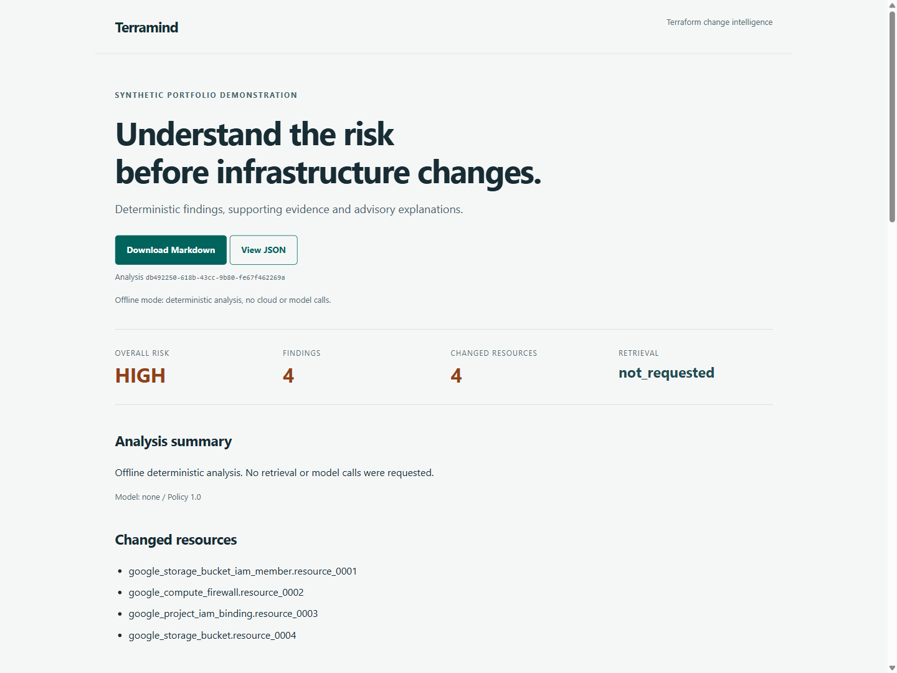

# Two-minute walkthrough

Use this sequence for a short application demonstration. All inputs are packaged
synthetic examples. Install dependencies before recording so setup time does not
interrupt the walkthrough. No cloud access is needed for the default demonstration.

## Prepare

```sh
uv sync --locked
uv run --locked python scripts/demo_offline.py
uv run --locked --extra api python -m terramind.api
```

Keep the server terminal open and visit `http://127.0.0.1:8080/demo`. Local mode
has no cloud/model calls. Reports are held in memory and disappear on restart or expiry.

## Present

| Time | Action | Point to explain |
| --- | --- | --- |
| 0:00-0:20 | Show the README architecture and demo preview | Terraform values stay local; the hosted demonstration uses synthetic facts |
| 0:20-0:40 | Select Analyze synthetic sample | Four deterministic findings produce overall HIGH risk |
| 0:40-1:10 | Scroll through findings and observed facts | Stable rule IDs, evidence, remediation and REVIEW status; no claim of deployed exposure or backup readiness |
| 1:10-1:30 | Download Markdown and open View JSON | Both exports derive from the same saved report; offline retrieval is not_requested and model is null |
| 1:30-1:45 | Show the published synthetic Gemini report | Advisory explanations cite reviewed documents and cannot change deterministic severity |
| 1:45-2:00 | Show deployment and release evidence | 297 tests, 10/10 retrieval queries, protected WIF delivery, private API and documented cost/cleanup limits |

Suggested opening: "Terramind reviews proposed infrastructure changes using
four deterministic GCP rules. Gemini explains those existing findings using
retrieved synthetic runbooks. It never approves or applies a change."



The [finding details](images/findings-desktop.png) and [mobile capture](images/report-mobile.png)
come from the same local offline report. They are actual browser captures, not
mockups or a claim of cloud model execution.

## Reproduce the API and benign case

In a second terminal:

```sh
uv run --locked python scripts/demo_cloud.py --url http://127.0.0.1:8080 --local
uv run --locked terramind analyze --input examples/normalized-plans/no_changes.json --output artifacts/benign.md --format markdown
```

The HTTP check must preserve all four findings and verify stored JSON, Markdown
and HTML. The benign report must show `NO_KNOWN_FINDINGS`, with visible limitations.
For prevention-aware behavior, analyze `public_bucket_pap_enforced.json`:
TM-GCP-001 remains HIGH with REVIEW, without asserting actual public exposure.

## Explain the cloud result

The [cloud API verification](api-delivery-verification.md) records a real protected
deployment, successful WIF exchange and one authenticated Gemini/Firestore analysis.
It preserved four findings, validated ten sources and took 10.898 seconds in that
observation. This is separate from the local screenshots and is not a latency SLA.
The [published advisory](../examples/generated-reports/grounded-synthetic.md) was
produced by the earlier live CLI evaluation, not by the screenshot session.

For authorized read access, use the [Cloud Run proxy](analysis-api.md#authentication-and-presentation)
and inspect an existing unexpired report. The demo preview and saved-report reads
do not request model generation. Selecting Analyze on the cloud demo does.
Do not rerun paid ingestion or synthesis just to present existing evidence.

A new approved live analysis can use `make demo-cloud` with a short-lived identity
token held only in the environment, following [controlled delivery](delivery.md#cloud-demonstration).
Never put tokens in URLs, recordings, screenshots or browser storage.

## Close with limitations

The analyzer covers four policies and synthetic demonstration data only. AI prose
can be wrong even when citations are valid. The private demo has shared report
access for authorized invokers, not per-user ownership. Cloud resources remain
active with minimum zero and maximum one instance. Alerts do not stop spending;
[cleanup](cost-and-cleanup.md#cleanup-order) remains an explicit operator task.
