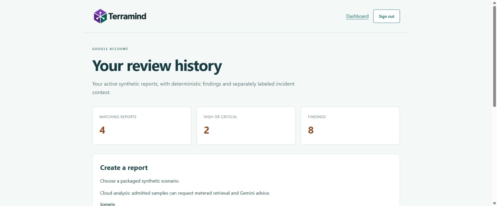

# Hosted integration verification

Live verification on 2026-11-10 uses synthetic data in the dedicated approved
Google Cloud project. This record supplements the historical local checks and
the historical [activation proposal](live-activation-plan.md). Real PR publishing,
Eventarc delivery, Google portal login and durable report workflows were exercised.
Billing was disabled again at 15:35 UTC (22:35 Asia/Jakarta), and the project was
retained. See the [content-free evidence](evaluations/live-integrations-2026-11-10.json).
Model advisory success is qualified below; the latest strict deployment smoke
did not pass.

## Trusted PR review and delivery

[PR #1](https://github.com/mdaninas/terramind-gcp/pull/1) exercised all eight rules
and both optional packs through the trusted-main manual workflow. Two successful
attempts of [review run 42788780002](https://github.com/mdaninas/terramind-gcp/actions/runs/42788780002)
produced one managed bot comment, without duplicates, and neutral head checks.
The published review identifies the exact analyzed head,
`9c241a7cb49dba84808aec2681343c2aaf59f049`.

The reviewed PR passed CI and merged as
`743008fc4d5946b25a39114adb372f99104e9306`.
[Protected deployment 42790086598](https://github.com/mdaninas/terramind-gcp/actions/runs/42790086598)
passed the required owner review, WIF authentication, private-runtime checks,
immutable image publication and end-to-end cloud analysis with an advisory.
This consumed one of the six approved analysis requests.

The first deployed application image digest was
`sha256:064d19ea6482132d9c0912dbb9f35d2018239b2be7532dce18185a32f09efc1c`.
The Eventarc receiver and portal initially used this image. A Terraform-only
correction configures the exact hostname returned by Cloud Run for the official
authenticated proxy. It changes the portal environment and probe Host headers.

The live browser exposed a separate login issue: Chrome blocked the form's
cross-origin OAuth redirect under `form-action 'self'`. The corrected form
renders a same-origin continuation page with a Google link, preserving that CSP.
A local real-browser regression reached a separate synthetic origin successfully;
the full 493-test quality gate and six portal Terraform cases passed. This local
regression preceded the real Google login described below.

[PR #2](https://github.com/mdaninas/terramind-gcp/pull/2) passed both CI jobs and
merged as `47bb7a3bb0d61f1e1960b30137ea16118ad833e7` without a co-author trailer.
[Deployment 42796722087](https://github.com/mdaninas/terramind-gcp/actions/runs/42796722087)
passed its trusted build, environment approval, WIF and image promotion. Its
strict advisory smoke failed: a real report was stored with four unchanged HIGH
findings and available retrieval, but no validated advisory. The safe response
does not identify whether generation, its deadline or validation caused fallback.
No model request was repeated to obtain a green workflow.

The resulting image, deployed to all three services before billing shutdown, is
`sha256:ad1c87ca41ee08cdeb9b44a196894d5421fbed805506c66bf980306ace6a92a0`.
The same image subsequently returned a validated Gemini advisory through the
portal. This establishes successful advisory delivery for that sample, not
deterministic availability of model responses.

## Real Eventarc delivery

The receiver and trigger were applied with separate runtime and delivery
identities, internal ingress and authenticated invocation. Service-agent
initialization and IAM propagation required retries of the remaining additions.
No unrelated deletion was applied.

Observed against the real bucket, Eventarc subscription and Firestore database:

- Before publishing: ten indexed documents, ten chunks and no ingestion receipts.
- An expired synthetic corpus lease was created using a create-only precondition.
  Uploading the canonical Storage hardening source produced a receipt, removed
  that lease and synchronized all twelve packaged documents.
- Publishing the Database hardening source produced a second receipt. Reuploading
  identical Storage content created a new generation and a third receipt. All
  twelve knowledge document update times remained unchanged after these uploads.
- A timestamp seek on the existing Eventarc subscription replayed the three
  retained messages. Pub/Sub push metrics increased from two ACKs before the
  third upload to six ACKs after the third upload and replay. Receipt count
  remained three and all knowledge document update times remained unchanged.
- One synthetic object path absent from the current package was acknowledged
  without a new receipt or knowledge update. The eventual push metric was seven
  `ack_200` responses, with three receipts and twelve unchanged chunks.
- Every one of the twelve canonical source objects matched its packaged body,
  SHA-256 metadata and synthetic marker.

Acknowledged-message retention was enabled only for this bounded replay test and
restored to its original disabled setting. Metrics establish successful delivery
and state invariance; they are not an independent count of embedding API calls.
Expired-lease recovery was exercised live. An active worker's stale commit fence
remains covered by local transaction tests rather than a live concurrent-worker
experiment.

## Portal and operating state

The private portal, separate Firestore database, index, TTL policies and
Secret Manager runtime binding were applied. Google OAuth uses an External
testing client, one approved test user and the exact loopback callback. Only the
approved operator has Cloud Run invoker access. The owner completed the real
Google selection and consent, and the application returned to its dashboard.

| Portal sample | Policy result | Retrieval and advisory | Incident Memory |
| --- | --- | --- | --- |
| Core risk | Four HIGH findings, rules 001-004 | Available retrieval, validated Gemini 3.5 Flash advisory | Available, three fabricated matches |
| Storage hardening | Two findings, overall MEDIUM, rules 005-006 | Available retrieval, visible advisory fallback | Partial curated coverage |
| Database hardening | Two HIGH findings, rules 007-008 | Available retrieval, visible advisory fallback | Partial curated coverage |
| No proposed changes | Zero findings, NO_KNOWN_FINDINGS | Not requested, no retrieval or model call | Not requested |

All four JSON exports passed the strict report/incident contracts and matched
the real Firestore records. Findings for the three risk samples matched their
deterministic local results exactly. The core Markdown download retained all four
rule IDs and its separate Incident Memory section. The incident source page
displayed its fabricated-data label and SHA-256 provenance.

A same-image revision named `terramind-portal-verify-state` received 100% of
traffic. The existing browser session still opened its previously saved report
and history without another login. The temporary revision name and CLI metadata
were then reconciled through a reviewed Terraform update. Session/report
persistence is demonstrated across revisions, not inferred from storage settings.

History contained four reports, two HIGH reports and eight findings. Combined
HIGH/rule-007/UTC-date filters returned the expected single report; CRITICAL
returned the empty state. An owner query parameter was rejected. Logout returned
to the login page, and the subsequent history request required sign-in. Only one
real Google account was approved: cross-owner isolation and pagination beyond
the four-report live dataset remain covered by local tests.

Six analysis submissions were counted conservatively, including the no-change
sample that made no model call: two deployment smokes and four portal reports.
Two returned validated advisories, three used policy-preserving fallback and one
needed no advisory. Live advisory output for the optional packs was not validated
successfully in this bounded window. No additional paid evaluation was run.

All services retained invoker IAM and zero minimum/one maximum instance. Anonymous
API and portal requests returned 403; the internal receiver rejected external
traffic with 404. Portal TTL policies and the report index were ACTIVE/READY.
After testing, `gcloud billing projects unlink` and an independent billing read
confirmed `billingEnabled: false` and an empty billing-account association. The
console showed that the project has no billing account. The private local proxy
was stopped. Hosted billable services are paused; project retention does not
establish individual resource deletion or future data recoverability.

Public evidence excludes OAuth secrets, tokens, login callback URLs, account
emails, raw plans, state and private report storage. Detailed operator artifacts
remain ignored under `artifacts/live-activation/`.
