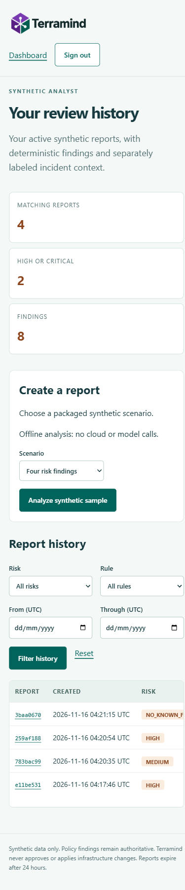
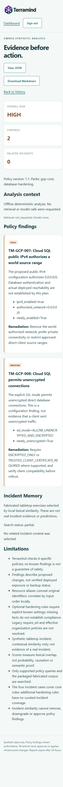

# Local verification and portal responsive layout

Historical layout-correction record. The subsequent [interface refresh](ui-verification.md)
updates the portal and standalone report; the measurements below retain their
original source and scope.

Verified on 2026-11-16 (Asia/Jakarta) in the existing Windows checkout. This
follow-up reconciles stale documentation and completes the previously missing
local mobile-width portal checks. All analysis inputs and accounts were synthetic.
The portal changes are local working-tree changes and have not been deployed.
The latest cloud evidence remains the separate
[2026-11-13 operational record](operational-verification.md).

See the [content-free results](evaluations/local-2026-11-16.json).

## Corrections

- Long resource-type and TLS evidence overflowed narrow report panels. Finding
  text now wraps without changing its content or severity.
- A native Risk select exceeded its column and overlapped the Rule filter. Form
  controls can now shrink to fit their labels.
- The history table compressed identifiers, timestamps and rules into tall rows.
  It now preserves a 720-pixel minimum width inside its horizontal scroll
  container, keeps report IDs/timestamps together and aligns cells at the top.
- Opening raw JSON caused a browser request for `/favicon.ico` to return 404.
  The portal now serves the existing packaged icon at that route.
- Guides distinguish the original ten-document retrieval baseline from the
  twelve-document corpus, initial optional-pack fallback from later successful
  advisories, published releases from historical preparation, and the retained
  billing-disabled project from a claim of deleted resources.

## Browser checks

The dedicated browser session used Chromium 157.0.8103.78, a loopback portal on
port 8094, demo authentication, offline analysis and a separate SQLite database.
No Google login, cloud data access or paid model calls were used.

| View | Widths in CSS pixels | Result |
| --- | --- | --- |
| Sign in | 320, 360, 390, 768, 1280 | Controls fit; no horizontal page overflow |
| Dashboard with four reports | 320, 360, 390, 768, 1280 | Filters fit their columns; history scrolling remains contained |
| Core risk report | 320, 360, 390, 768, 1280 | Four findings retained; long evidence fits |
| Storage report | 320, 360, 390, 768, 1280 | Two findings retained; long evidence fits |
| Database report | 320, 360, 390, 768, 1280 | Two findings retained; long TLS evidence fits |
| No-change report | 320, 360, 390, 768, 1280 | Zero findings; `NO_KNOWN_FINDINGS` fits |
| Synthetic incident detail | 320, 360, 390, 768, 1280 | Source text and hash wrap within the page |

All 35 page/viewport combinations passed geometry checks and produced screenshots.
Selected phone-width captures were visually inspected. The history table retains
horizontal scrolling on narrow screens; it does not widen the whole page.





At phone-width viewports, both demo accounts completed login and logout. The analyst
created exactly four reports: core HIGH with four findings, Storage MEDIUM with
two, Database HIGH with two, and no-change with zero. Dashboard totals were four
reports, two high-risk reports and eight findings. Risk HIGH selected two reports
with six findings; adding TM-GCP-007 selected the Database report with two findings.
An inclusive 2026-11-16 UTC date range retained that matching report.

The core JSON export retained four HIGH findings, three incident matches and
`model_id=null` / `rag_status=not_requested`. The Markdown link downloaded a
report with all four rule IDs. An expanded provenance panel remained inside the
320-pixel viewport. A server restart preserved the analyst session and all four
reports. The reviewer had an empty history and received 404 for the analyst's
HTML, JSON and Markdown. History returned 401 after each logout. The favicon
returned 200 with `image/x-icon`; the rechecked JSON page had no console errors or
warnings after the correction.

These are responsive desktop-Chromium checks. They do not establish physical
phone behavior, touch interaction, Safari/Firefox rendering, live Google login,
large-scale capacity or a new hosted rollout. Earlier cloud results retain their
original scope. Actual budget email receipt remains unverified.

## Local quality gate

| Check | Result |
| --- | --- |
| Full Python suite after portal corrections | 538 passed in 29.50 seconds |
| Normalization/policy branch coverage | 97.19%, above the 80% gate |
| Ruff lint and formatting | Passed, 159 files formatted |
| Strict mypy | Passed, 74 source files |
| Exported schemas and packaged corpus drift | Passed |
| Public-file privacy and diff whitespace | Passed |
| Offline deterministic demo | Four HIGH findings |
| Local retrieval double | 10/10 curated queries, twelve documents/chunks, zero cloud calls |
| Synthetic 100-change benchmark | 0.004066 seconds, below the two-second gate |
| Terraform formatting and validation | Passed, all four configuration roots |
| Terraform mock-provider plans | 30 passed: project 5, bootstrap 2, dev 17, portal 6 |

Terraform checks used an isolated copy of tracked files and the existing provider
cache, without operator variable/backend files, cloud calls or `terraform apply`.
The sandboxed API attempt stalled in Windows asyncio loopback initialization;
rerunning with local socket access passed. An initial Terraform attempt read
operator variable files and failed default-configuration assertions; the isolated
tracked copy passed all 30 tests. Neither attempt is presented as a cloud result.

The full check used the existing virtual environment:

```powershell
& ./.venv/Scripts/python.exe scripts/check.py
& ./.venv/Scripts/python.exe scripts/check_public_files.py
```

The usual `uv run --locked` commands remain documented in the README. The initial
audit could not access the configured uv cache from its sandbox and used the
existing environment directly. Package builds, dependency vulnerability scans,
container builds and Checkov were not repeated here; their historical evidence
remains separate. No new hosted CI or release is claimed.

Both local sessions were logged out, the dedicated browser was closed and the
portal listener was stopped. SQLite, downloads and browser snapshots remain in
ignored local storage. Only selected synthetic screenshots and content-free
measurements are versionable evidence.
