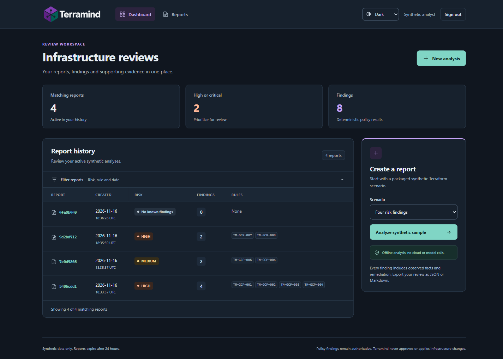

# Color themes and verification

The portal and standalone report support **System**, **Light** and **Dark** in the
header's Color theme selector. On narrow screens the selector appears as an
appearance icon. System is the default and follows the device setting, including
changes while the page is open. An explicit Light or Dark choice overrides it.

The preference is stored as `terramind.theme` in browser local storage for the
current origin. It persists through reload, login, report navigation and logout,
and synchronizes with other tabs on the same origin. It contains only a theme
name, with no account, report, plan or authentication data. Separate portal/API
origins keep independent preferences.

The local script applies the preference before styles load. Both interfaces use
the same palette, native selector and theme-appropriate logo. Invalid stored
values fall back to System. If storage is blocked, manual selection still works
in the open page and survives its page-restoration handler. New navigations
cannot retain a choice that the browser refused to store. With JavaScript
disabled, CSS follows the device setting and the inactive selector is hidden.

Verified on 2026-11-17 (Asia/Jakarta), using synthetic local inputs only. These
changes have not been deployed. See the [content-free evidence](evaluations/theme-2026-11-17.json).
The earlier [interface refresh](ui-verification.md) retains its original scope.

The [mobile dashboard](images/portal-dark-mobile.png) and
[standalone dark report](images/report-dark-desktop.png) are actual browser
captures. Light mode remains available through the same selector.

## Verification

| Check | Result |
| --- | --- |
| Full Python quality gate | 539 tests passed in 31.42 seconds |
| Lint, formatting, types, schemas and corpus | Passed; mypy checked 75 source files |
| Normalization/policy coverage | 97.19%, above the 80% gate |
| JavaScript syntax | `node --check` passed |
| Portal layout | Nine views/states, both themes, 320/390/768/1440 pixels: 72 cases passed |
| API layout | Preview and saved report, both themes at the same widths: 16 cases passed |
| Theme behavior | System tracking, explicit overrides, reload, login/report/logout persistence, reset to System, cross-tab updates and invalid-value fallback passed |
| Keyboard | Native selector changes theme with arrow keys and retains visible focus |
| Restricted browser settings | Denied reads/writes, failed writes with an older stored choice, and JavaScript-disabled CSS fallback passed |
| Findings and exports | Core four findings and FAIL/REVIEW statuses retained; real JSON/Markdown navigation/downloads passed |
| Account boundaries | Reviewer history empty; analyst HTML/JSON/Markdown returned 404 to reviewer; history returned 401 after logout |
| Browser console | No errors or warnings observed on final tested flows |
| Packaging | Wheel and source archive built offline; shared theme files, logos and presentation module checked in the wheel |

Portal scenarios retained their expected results: core HIGH with four findings,
Storage MEDIUM with two, Database HIGH with two, and no-change with zero. No known
findings retains a neutral presentation and its safety caveat. Expanded incident
text and provenance remained inside a 320-pixel viewport.

The shared palette covers inputs, tables, metrics, evidence, remediation, advisory
sources, severity labels, focus and footers. Reviewed text/panel pairs exceed
4.5:1; the corrected light input border also exceeds 3:1 on white. These are
scoped contrast, keyboard and responsive checks, not a complete accessibility audit
or physical-device/cross-browser verification.

The portal permits only same-origin scripts, without inline-script permission;
form, host, CSRF and ownership checks remain enforced. Theme changes make no
analysis or provider calls. Browser QA created four offline portal reports and
two offline API reports. No cloud provisioning, IAM, billing or deployment change
was performed. Both demo sessions were logged out, dedicated browsers closed and
local QA servers stopped. Raw snapshots, downloads and SQLite data remain ignored.
