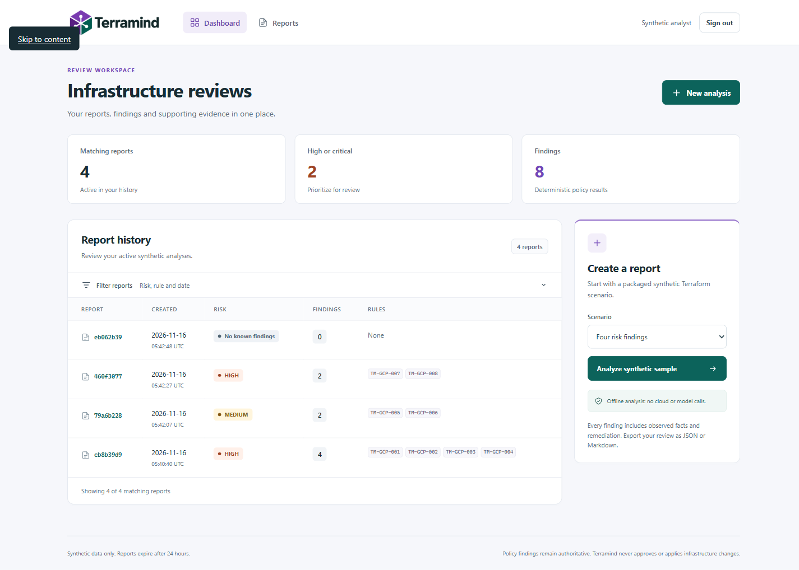

# Portal and report interface verification

The subsequent [color-theme implementation](theme-verification.md) adds System,
Light and Dark preferences to both interfaces. The refresh results below retain
their original 2026-11-16 source and scope.

The 2026-11-16 interface refresh updates the portal and standalone analysis
report in the local checkout. It uses the existing violet/teal brand, local assets
and system fonts. No new frontend framework, remote asset or browser token storage
was introduced. These changes have not been deployed.

The [verification results](evaluations/ui-2026-11-16.json) distinguish this refresh
from the earlier [local layout corrections](local-verification.md) and historical
[cloud operating results](operational-verification.md).

## Interface changes

- A compact workspace header, clear page hierarchy and direct report navigation.
- Smaller summary cards that keep the dashboard useful on narrow screens.
- A history workspace with a separate analysis form, collapsible filters, active
  filter counts and a readable, keyboard-scrollable table.
- Severity-specific text labels and colors. `FAIL` and `REVIEW` remain separate
  from severity; no known findings uses a neutral appearance and retains caveats.
- Finding cards group resource aliases, observed facts and remediation. Report
  anchors lead to findings, context and limitations without hiding their content.
- Incident excerpts and provenance use native disclosure controls. Full text,
  source hashes and synthetic-evidence labels remain available.
- Skip links, visible keyboard focus, semantic table headers, stronger small-text
  contrast and reduced-motion support.

The [mobile dashboard](images/portal-ui-mobile.png),
[standalone report](images/report-ui-desktop.png) and
[mobile report](images/report-ui-mobile.png) are actual local browser captures.

## Verified behavior

| Check | Result |
| --- | --- |
| Full Python quality gate | 538 tests passed in 28.23 seconds; lint, formatting, types, schemas and corpus checks passed |
| Normalization/policy coverage | 97.19%, above the 80% gate |
| Portal responsive checks | Nine views/states at 320, 360, 390, 768, 1024 and 1440 pixels, 54 combinations |
| Standalone report responsive checks | Preview and saved report at 320, 390, 768 and 1440 pixels, eight combinations |
| Overflow and navigation | No horizontal page/evidence overflow, overlapping form columns, heading/action collisions or dangling in-page anchors in tested states |
| Portal scenarios | Core HIGH with four findings, Storage MEDIUM with two, Database HIGH with two, no-change with zero |
| Filter panel | Native disclosure opens; risk/rule/date filtering returns the expected Database report and retains four active filters |
| JSON and Markdown | Actual download/navigation flows preserve findings, statuses and offline model/retrieval labels |
| Keyboard | Skip links focus main content; history table accepts focus and ArrowRight scrolling with an inset focus outline |
| Reduced motion | Portal transitions disabled; standalone report section navigation works without smooth scrolling |
| Ownership and logout | Reviewer has no reports; analyst HTML/JSON/Markdown return 404 to reviewer; history returns 401 after each logout |
| Browser console | No errors or warnings observed on the final tested flows |

Small-text review darkened the portal table headers, resource/provenance labels
and footer, plus standalone finding indices and resource references. The corrected
API text measures 5.11:1 on white; the portal muted token also exceeds 4.5:1 on
its white/canvas/table-header backgrounds. This is a scoped contrast and keyboard
review, not a complete accessibility audit.

The browser work created four offline portal reports and three offline standalone
reports, including repeat checks after loading final markup/colors. No model,
embedding or other cloud provider calls were made. Both demo sessions were logged
out, dedicated browsers closed and local QA servers stopped. SQLite databases,
downloads and raw browser snapshots remain in ignored local storage.

These checks use responsive desktop Chromium. They do not establish physical
phone or touch behavior, Safari/Firefox rendering, a new Google-login verification
or hosted deployment. The policy engine, API schemas, authentication and report
storage contracts were unchanged. Existing tests verify escaping and preserve
deterministic findings, including the advisory path.
