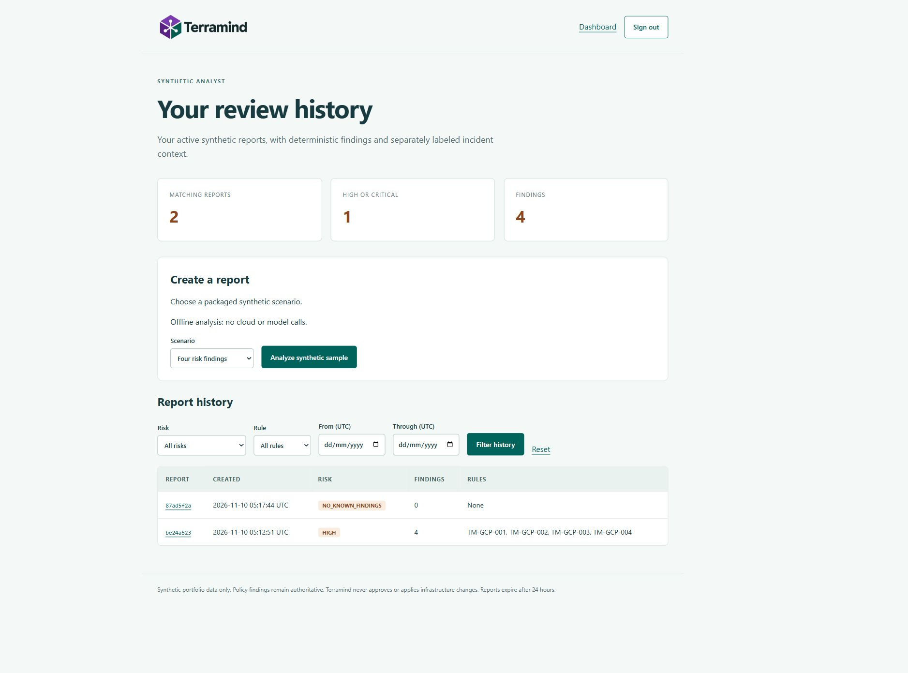

# User portal, login and report history

The portal is a separate server-rendered application with Google OpenID Connect
configuration, local synthetic demo accounts, owner-scoped reports, a dashboard
and paginated history filters. Local API, cryptographic verifier and browser
checks passed. A live Google sign-in and hosted portal deployment have not been
performed. See the [verification record](portal-verification.md).

## Try the local synthetic demo

Install the locked portal dependencies. In PowerShell, run:

```powershell
$env:TERRAMIND_SERVICE = 'portal'
$env:HOST = '127.0.0.1'
$env:PORT = '8080'
$env:PORTAL_ORIGIN = 'http://127.0.0.1:8080'
$env:PORTAL_AUTH_MODE = 'demo'
$env:PORTAL_ANALYSIS_MODE = 'offline'
$env:PORTAL_DATABASE = 'artifacts/portal.sqlite3'
uv run --locked --extra portal python -m terramind.api
```

Open `http://127.0.0.1:8080/login`. Choose the synthetic analyst or reviewer,
create either packaged sample and inspect its report, incident context and exports.
Sign out and choose the other account to see a separate history. These disposable
accounts demonstrate ownership behavior; they are not identity verification.
Demo mode rejects non-loopback client connections and Cloud Run environments,
and the supported entry point refuses a public-interface demo bind.

The dashboard supports risk, rule and UTC date filters, with 20 reports per page.
Counts use the same owner, expiry and filters as the list; HIGH and CRITICAL
reports contribute to the high-risk total. Cursor pagination uses creation time
and UUID to handle tied timestamps. Empty filters and empty histories have
explicit UI states. Reports can be read as HTML, exported as a JSON bundle or
downloaded as Markdown with the separately labeled incident context.



Actual local synthetic-login capture. This does not show a live Google sign-in,
cloud analysis or hosted deployment.

## Configure Google login

Create or select a reviewed Google OAuth web client and register exactly
`PORTAL_ORIGIN/auth/callback` as its authorized redirect URI. Provider setup is an
operator action; no OAuth client or new access grant was created during this work.
Supply these values through private environment or secret storage:

- `PORTAL_AUTH_MODE=google`.
- `PORTAL_ORIGIN`, an HTTPS origin, or an explicitly registered loopback HTTP
  origin for development. Do not include a path, query, fragment or credentials.
- `GOOGLE_OAUTH_CLIENT_ID` and `GOOGLE_OAUTH_CLIENT_SECRET`.
- `PORTAL_ALLOWED_EMAILS`, a comma-separated exact allowlist of verified Google
  email addresses. Wildcard/domain-wide admission is not supported.

The authorization request uses code flow with state, nonce and an S256 PKCE
challenge. A pending flow is bound to the browser's anonymous server session,
expires after five minutes and is consumed once before exchange. Redirect URIs
come only from configuration. The token exchange uses Google's fixed HTTPS
endpoint and does not follow redirects. Certificate requests have a five-second
timeout; the token request has a ten-second timeout and a bounded response body.

`google-auth` verifies signature, Google issuer, audience and token times with a
30-second clock-skew allowance. The application then checks nonce, authorized
party, verified email and exact allowlist. Ownership uses a SHA-256 of the
provider and stable Google `sub`, not an email supplied by a browser. Raw profile
names/emails and provider ID/access/refresh tokens are not saved in reports or
SQLite. Client secrets are not stored in SQLite or included in settings repr.
Pending nonces/verifiers and CSRF values are sensitive server-side state and are
held in the private database. Live provider/client compatibility, including PKCE
enforcement, remains a required smoke check before hosted use.

## Session and ownership boundary

Opaque random session tokens are stored only as SHA-256 digests on the server.
Successful login rotates the session and CSRF token; logout revokes the server
session. Sessions expire after 30 minutes idle or four hours absolute. They persist
across application restarts. Reducing the email allowlist does not immediately
revoke already issued sessions; expire or revoke those sessions during maintenance.

Cookies are HttpOnly and SameSite=Lax. HTTPS uses Secure, a `__Host-` name, root
path and no Domain attribute. State-changing forms require both an exact Origin
and a session-bound CSRF token. Referrers are restricted to origin, excluding
callback codes and report paths. CSP permits only local images/styles and forms;
no external JavaScript, browser token storage or password handling is used.

Every report read, export, list, count and filter binds to the authenticated
server-side owner. An existing report owned by another user returns the same 404
as an absent/expired report. A request cannot choose its owner through headers or
query fields. The portal does not mount the original shared-demo API; its SQLite
reports cannot be fetched through the old API's report namespace. The old
analysis app retains its documented shared authorized-demo boundary.

The local SQLite database uses parameterized queries and create-only report
writes. It retains active reports for at most 24 hours and removes expired rows
on subsequent state maintenance; read paths never serve expired reports. Idle
data can remain on disk until another maintenance request. There is no secure
erase or database encryption claim. Keep the database, journals and backups in
a private directory with appropriate operating-system permissions. The public
file check rejects common SQLite extensions, journals and SQLite headers.

Bounds: 512 active sessions, 512 active reports per owner, 2,048 active reports
overall, 600 KiB per report bundle, four KiB form bodies, and six admitted analyses
per minute with one analysis at a time per process. These availability/cost
controls are not enterprise rate limiting or tenant isolation.

## Optional cloud analysis and hosting limits

Offline is the default. `PORTAL_ANALYSIS_MODE=cloud` requires Google authentication,
the cloud extras, approved GCP configuration/credentials and active billing for
the metered services. It reuses the existing bounded retrieval/Gemini adapter and
preserves deterministic fallback findings. The UI labels that mode explicitly;
the report page includes advisory text and validated source references when present.
Both scenarios are generated server-side from synthetic facts. There is no
arbitrary plan upload or production-data submission flow.

SQLite makes this a single-host portal with private persistent disk. No new
Firestore history adapter, distributed session backend or Cloud Run portal
deployment is claimed. A managed hosted rollout needs a separate durable-storage
and ingress review. Cloud Run invoker IAM is independent of the portal's Google
session: a browser cookie does not replace a Google invoker token. Use an approved
authenticated proxy/access layer for a private hosted service; do not disable IAM
to make a login page reachable.

No billing, cloud IAM, OAuth settings or paid resources were changed for this
implementation. The earlier billing shutdown remains the last verified cloud
operating state. Additional hosting, credentials and paid calls require an
explicitly reviewed activation. All cloud/provider claims here are separated
from the local and mocked verification results.

References: [Google OpenID Connect](https://developers.google.com/identity/openid-connect/openid-connect),
[google-auth token verifier](https://googleapis.dev/python/google-auth/latest/reference/google.oauth2.id_token.html),
[OAuth security guidance](https://www.rfc-editor.org/rfc/rfc9700.html), and
[OWASP session management](https://cheatsheetseries.owasp.org/cheatsheets/Session_Management_Cheat_Sheet.html).
